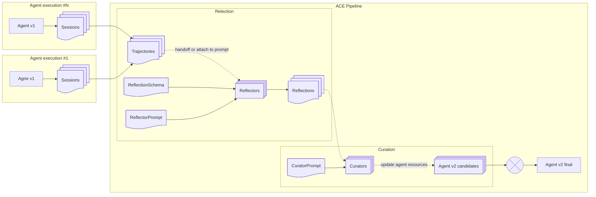

# Glossary

Shared definitions for `thearc`. These describe the domain first and identify
current Python types where useful. A concept can exist without a dedicated class.

## The learning cycle



Reflection produces findings. Curation turns findings into configuration changes.
Evaluation measures the candidate's behavior. Installation makes a configuration
available to an agent harness. Each is a separate step.

## Agents and configuration

### Agent

An executing system that uses a model, instructions, tools, and conversation
context to perform a task. Its execution produces events. The original agent,
reflector, and curator are roles that may use different models or runtimes.

### MetaAgent

A named, optionally versioned configuration of an agent's skills, hooks, context
documents, MCP connections, and other resources. It can be inspected, edited,
compared, saved, and installed into supported harnesses.

`MetaAgent` represents configuration; the runtime executes the agent using it.
A saved configuration does not establish which instructions were loaded in a
historical session.

### Resource and resource target

A **resource** is a configurable part of a MetaAgent. A **resource target** is its
address, optionally narrowed to a Markdown section. `ResourceTarget` identifies
the part being assessed or changed.

| Resource | Meaning |
| --- | --- |
| `Skill` | Reusable instructions, metadata, and supporting files for a capability. |
| Skill file | A supporting file addressed within a skill. |
| `ContextDocument` | Instructions or context supplied through a document such as `AGENTS.md`. |
| `Hook` | Configuration for an action triggered by a harness event. |
| `MCP` | Configuration for a connection to a Model Context Protocol server. |
| `AgentResource` | An additional configuration resource stored in an agent directory. |

### Harness, runtime, backend, and runner

- **Harness:** the agent environment that manages conversation, tools, and
  configuration conventions. A source harness also determines the native log format.
- **Runtime:** the executable CLI or SDK used to run an agent.
- **Implementation:** `thearc`'s integration with a runtime, selected when creating
  a `Reflector` or `Curator`. Execution provenance records its identity.
- **Runner:** the callable that performs an execution through that integration
  and returns its response and execution metadata.

The source harness, reflection backend, and installation target can differ in
evidence-based reflection. Native handoff requires a runtime capable of forking
the source conversation.

Source: [configuration models](thearc/models/agent.py),
[execution contracts](thearc/learning/reflection/runtime.py).

## Sessions and behavior

### Event

One normalized record of agent activity: for example, a message, tool call, tool
result, or metadata record. An indexed `Event` carries its content, relationships,
and a reference to the original record. `event_id` is sufficient to locate its
indexed session and provenance.

### Session

A recorded conversation and its associated events. A session can contain several
execution runs, including delegated work. The indexed `Session` object holds
identity and summary metadata; its events are stored and retrieved separately.

`thearc.resources.Session` is the immutable historical facade. It loads events on
first access and exposes splitting, scoped search, rendering, and `through(t)`.
The internal `thearc.learning.sessions.models.Session` is the index metadata record. A `SessionView`
is an immutable prefix; it includes the selected trajectory's prompt and response
as well as earlier history from the same captured session.

### Trajectory

The ordered chain of events triggered by one user prompt, ending at completion or
interruption. It includes recorded assistant text, thoughts, tool calls, tool
results, and other execution events. The triggering prompt is stored separately.

```text
S  = (p0, t0, p1, t1, ..., pk, tk)
ti = (ei0, ei1, ..., eiN)
```

A **session** contains successive prompt–trajectory pairs. A **trajectory** is the
response activity for one prompt. A **turn** is the pair `(pi, ti)`. Even a session
with one agent can contain many trajectories. One prompt may contain several
native content blocks.

`Trajectory` stores `prompt_events`, response `events`, and the observed boundary.
`split_trajectories()` uses normalized user messages and explicit lifecycle markers.
When completion is not recorded, the next prompt or end of the available stream
bounds the extracted trajectory without establishing successful completion.
Events preceding a prompt or outside its response remain in
`TrajectorySplit.unassigned_events`. Different runs and artifacts are split
independently because their ordering does not establish causal relationships.

The resource facade exposes this partition through `session.split_into_trajectories()`.
Its trajectory objects and nested event contents are immutable.

### Trajectory segment

A bounded portion of a trajectory selected for inspection. A sequence pattern
match identifies such a segment. A segment provides local evidence; broader
context may be needed to interpret it.

### Run

An execution context within an indexed session. The `Run` model groups events and
can identify a parent run for delegated work.

An **adaptation run** is different in scope: one execution of the learning pipeline,
potentially involving many sessions, reflections, and changes.

### Task and outcome

A **task** is the objective an agent is asked to perform. An **outcome** describes
what happened and the evidence supporting that conclusion. Reflections describe
recorded outcomes; held-out evaluation measures performance through `TaskScore`.

### Source, native ID, and canonical ID

A **source** is a configured collection of native logs. `SourceConfig` identifies
its root and format. A **native ID** belongs to the original runtime. A
**canonical ID** belongs to the index and is scoped to its source. APIs that fork
native sessions require native IDs; indexed queries use canonical IDs.

`thearc.resources.SessionStore` exposes immutable session handles over the local
SQLite index. Ingestion and normalized storage live in `thearc.learning.sessions`.

Source: [session models](thearc/learning/sessions/models.py),
[evaluation contracts](thearc/learning/ace/evaluation.py).

## Evidence and selection

### Evidence

Recorded information available to a reflector or evaluator to support a finding.
It can be supplied as selected events or inherited through a native session fork.
Evidence describes what was recorded; its coverage determines what can be assessed.

### Evidence snapshot and formatting

`EvidenceSnapshot` is a portable, integrity-checked capture of selected indexed
sessions and events, with provenance and coverage metadata. It is a separate export
facility from immutable resource history.

`evidence_to_markdown(events)` formats chosen events, including event IDs and
relevant tool relationships. The operator composes the prompt. Formatting adds no
selection or truncation. Coverage means which recorded events were delivered;
omission and truncation describe excluded events and shortened content respectively.

### Behavioral pattern, pattern scanner, and pattern match

- **`BehavioralPattern`:** a Python matcher that detects a specified sequence or
  condition in ordered events.
- **`PatternScanner`:** selects candidate sessions using SQLite filters, then
  matches their complete event sequences in Python, respecting stream boundaries.
- **`PatternMatch`:** one occurrence, including the exact event slice, positions,
  event IDs, pattern name, and contextual details.

A match is an observed signal for inspection. Its name or severity does not by
itself establish a cause or prove that the behavior was harmful.

Source: [evidence snapshot](thearc/learning/evidence/snapshot.py),
[evidence formatting](thearc/resources/formats.py),
[patterns](thearc/learning/sessions/patterns.py),
[scanner](thearc/learning/sessions/scanner.py).

## Reflection and handoff

### Reflection

The response produced by a **reflector agent** after inspecting evidence under a
reflection prompt. It contains findings, interpretations, suggested improvements,
and limitations grounded in that evidence.

```text
Reflection = AR(RP + Evidence)
```

Here `AR` is the reflector agent and `RP` is the reflection prompt. The equation
describes the inputs and output; evidence can be attached or already in context.
**Reflection is the reflector's response, not its entire session.**

The word **reflection process** refers to invoking the reflector and collecting
that response. In the current implementation:

- `thearc.resources.Reflection` exposes response `text`, validated `output`, and
  host provenance. `output_schema` can be a caller-defined `ReflectionBaseModel`
  or JSON Schema; without one, `output` is text.

### Output schema and resource validation

`ReflectionBaseModel` and `CurationBaseModel` generate JSON Schema strings with
field descriptions and nested definitions. Schemas describe the expected response
and are embedded in the request. Structural validation checks the returned JSON;
optional resource validation resolves typed `ResourceTarget` references against a
captured MetaAgent. Existence does not prove historical usage. Curation targets are
validated according to their operation against a detached candidate.

### Reference and active configuration

The `agent` argument is the evaluated `MetaAgent`. In **reference** mode, its
resources are supplied for inspection. In **active** mode, supported resources are
also applied to the reflector for that call. The reflector's execution configuration
remains separate. The result records the mode and configuration revision; activation
does not automatically carry into curation. Supported activation depends on the adapter.

### Reflection item and citation

A `ReflectionItem` is a structured finding about a particular resource target,
with a helpful, neutral, or harmful rating, a reason, evidence citations, and
limitations. A **citation** identifies an event supporting the finding. The
reflector supplies `event_id`; the host resolves its session for saved records.

### Reflection prompt

The instructions that define what the reflector should inspect and how it should
respond. The prompt establishes the reflection task; the evidence supplies the
observations on which the response should be based.

### Native handoff reflection and reflector session

Native handoff reflection continues a fork of a session produced by another agent:

```text
S1  = (p0, t0, ..., pk, tk)
S1R = AR(fork(S1) + RP)
    = S1 + (RP, tR)
Reflection = final response within tR
```

`S1` is the original session. `S1R` is the **reflector session**, including inherited
history, the appended prompt, and the reflector trajectory `tR`. The inherited session
is the evidence, so no separate evidence payload is attached. The original session
remains unchanged. The equation describes logical history; a runtime may store
inherited history by reference.

`reflector.handoff(RP, trajectory)` supplies only that prompt and response.
`reflector.handoff(RP, session.through(trajectory))` includes the earlier prefix.
A native fork requires an unambiguous recorded cutoff. Otherwise supported history
is translated into a fresh reflector session. The source history remains immutable.

`NativeSessionRef` and `ForkReceipt` are internal runtime locator/receipt records.
The public `Reflection` stores the response and provenance for either path.

### Offline handoff plan

A `HandoffPlan` packages a task, evidence, and observed workspace identity for
later use. Preparing a plan is an offline operation. Native handoff reflection
uses a native session reference and prompt through a separate API.

### Session translation

Conversion of text messages between provider formats or into Markdown.
`SessionTranslator` creates a `ConversionPlan` with an explicit target format.
Translation preserves a selected representation of messages; it does not provide
the complete event history and continuity of a native fork.

Source: [reflection engine](thearc/resources/reflection.py),
[native handoff](thearc/resources/reflection.py),
[offline plans](thearc/learning/runtime/handoff.py),
[handoff interface](docs/guides/resources.md).

## Curation and evaluation

### Curation

The process of using reflections and change history to propose and apply justified
changes to a MetaAgent. A **curator** performs this work. Its result can include
additions, edits, removals, or a decision to keep the configuration unchanged.

The Python `Curation` model represents **one proposed operation** on a resource or
section, including its rationale and links to supporting reflections and evidence.
`CurationResult` records the revised MetaAgent and validated changes.

The resource facade's `Curator.curate()` returns a `CurationResult` containing a
detached revised agent, actual changes, and the model's report. `CurationReport`
is the standard output schema; custom schemas require an explicit operation
adapter. Supplying `output=` additionally saves a validated curation epoch.

### Baseline and candidate

The **baseline** is the starting MetaAgent configuration. A **candidate** is a
proposed adapted configuration. These roles are relative to a particular
adaptation or comparison; producing a candidate does not establish improvement.

### Assessment and ranks

An `Assessment` records a reflection rating against a particular revision of a
resource, with supporting evidence. The `AssessmentLedger` tracks these records
and whether each contributes to counts, including handling overlapping evidence.

`Ranks` are counts of helpful, neutral, and harmful feedback. They summarize
assessments; measured task performance is recorded separately by evaluation.

### Curation epoch

A committed curation record linking the resulting configuration, reflections,
changes, assessments, and parent epoch. Epoch history provides the ancestry of
configuration changes. Committing an epoch does not install the configuration or
automatically assign a new release version.

### Merge

Combining independent curation results that share the exact same baseline MetaAgent.
`Merger` compares all candidates together, combines independent fields and non-overlapping
line edits, and identifies conflicting additions, edits, or removals. A supplied
`Curator` provides typed conflict decisions through its configured executor.

`MergeReport` records selection, combination, retention of baseline content, or unresolved
conflicts. `MergeResult` preserves source proposals, decisions, the deduplicated assessment
ledger, and the merged agent. Unresolved structural conflicts or consistency-review issues
block access to `.agent`. Merging leaves all source artifacts unchanged and does not prove
that the combined guidance improves behavior.

### Evaluation

Measurement of agent behavior against defined tasks and criteria. The current
`compare_agents()` API compares baseline and candidate MetaAgents on the same
held-out tasks through a caller-supplied evaluator.

`TaskScore` records success, cost, and latency. `EvaluationResult` holds individual
scores and aggregate comparisons. Reflection can suggest why behavior occurred;
evaluation measures performance under the chosen test conditions.

### ACE and adaptation run

**ACE** means agentic context engineering: using recorded experience to improve
an agent's configuration. An adaptation run coordinates selection, evidence
preparation, reflection, curation, and optionally evaluation. Callers compose
these steps through the resource interface; `cookbook/resource_ace.py` is an example.

### Workspace and installation

A **MetaAgent workspace** is the canonical filesystem representation saved by
`MetaAgent.to_workspace()`. An **execution workspace** is the project or worktree
where an agent performs tasks. Specify which meaning applies when using the word.

**Installation** writes a MetaAgent's resources into a target harness's
configuration layout. It is a separate action from generating a reflection,
committing a curation epoch, or evaluating a candidate.

Source: [learning contracts](thearc/learning/curation/models.py),
[assessments](thearc/learning/curation/assessments.py),
[epochs](thearc/learning/curation/epochs.py),
[evaluation](thearc/learning/ace/evaluation.py).
