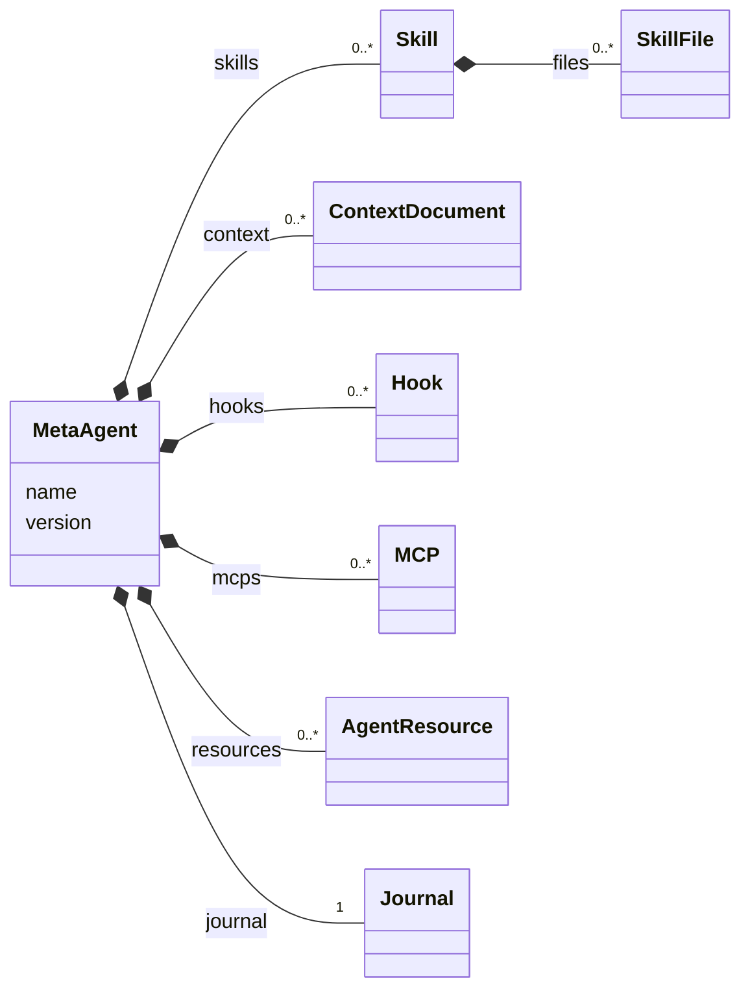
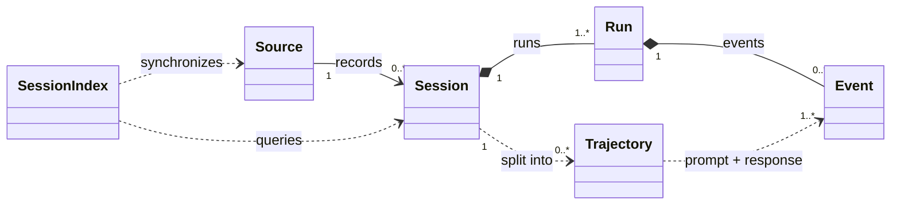

# Glossary

Shared definitions for `thearc`. These describe the domain first and identify
current Python types where useful. A concept can exist without a dedicated class.

## The learning cycle


## MetaAgent

### MetaAgent

A **MetaAgent** is the portable, harness-independent definition of everything that
shapes an agent's behavior apart from the model itself: its skills, context
documents, hooks, MCP connections, and other harness resources. It is the unit
the learning cycle improves — reflection assesses it and installation deploys
it.

A MetaAgent is *configuration*, not execution:

- An **Agent** is the running system; a MetaAgent is what gets installed into
  its harness before it runs. The same MetaAgent can be installed into different
  harnesses (Claude Code, Codex, Antigravity, Pi).
- A MetaAgent does not record what an agent actually loaded during a historical
  session. Linking a session to the configuration it ran with requires the
  installed identity (name and version), not the current definition.



### Identity

A MetaAgent is identified by a **name** and an optional **version**. The name is
a single safe filename component, so it can name directories and version markers
on disk. The version is a free-form, single-line label; it carries no ordering
semantics. Installation writes both, together with the revision, into the target
as an **identity marker** so an installed configuration can be traced back to the
exact MetaAgent configuration it came from.

### Installation

**Installation** deploys a MetaAgent into one harness's native project layout:
skills as `SKILL.md` with YAML frontmatter, rules/workflows/commands into their
directories, context documents at the project root, and hooks and MCP servers
merged into the harness's own configuration files. Supported harnesses are
`claude`, `codex`, `antigravity`, and `pi`.

An installation **owns** what it wrote; the identity marker lists those files,
context sections, hooks, and MCP servers. Reinstalling replaces exactly what it
owns and leaves everything else in the project alone. Importing an installation
reads the harness layout back into a MetaAgent.

- **Rebuilt files** — skills, rules, workflows, commands, and hook scripts are
  written whole. Overwriting a file the MetaAgent does not own is a conflict
  unless forced.
- **Merged context documents** — `AGENTS.md`, `CLAUDE.md`, and the like usually
  hold the project's own instructions. If one already exists, the MetaAgent's
  top-level sections are merged by heading title: a section with the same title
  is replaced in place, a new one is appended, and the rest of the document is
  kept. Sections the MetaAgent no longer has are removed on reinstall. A
  document thearc created is owned whole.
- **Merged configuration** — hooks and MCP servers go into the harness's own
  files (`.claude/settings.json`, `.mcp.json`, `.codex/hooks.json`,
  `.codex/config.toml`, ...) next to entries the MetaAgent does not own.
  Resources a harness cannot express (Pi has no hooks or MCP servers) are
  skipped and reported.
- **Hooks per harness** — a hook can be limited to some harnesses (its
  `harnesses`; empty means all), because matchers name a harness's own tools:
  Graphify guards `Bash|Grep` and `Read|Glob` in Claude but checks `Bash` in
  Codex. Hooks found in a harness's files that thearc did not install are
  imported limited to that harness, so imports from several harnesses combine
  into one MetaAgent.
- **Owned hooks** — (stored in the agent file `owned_hooks.json`, so they are
  part of the revision and a curator can edit them) a hook in a harness's file belongs to the MetaAgent if a
  previous install recorded it in the marker, or if its command matches one of
  the MetaAgent's `owns_hooks` glob patterns (e.g. `graphify *`). Every install
  first removes all hooks the MetaAgent owns, then adds its current ones, so
  hooks installed by hand or by an older version are replaced rather than
  duplicated, and everyone else's hooks are kept.

### Resource

A **resource** is one independently addressable part of a MetaAgent. Each kind
is keyed by its own identity, which is unique within its collection.

| Resource | Keyed by | Meaning |
| --- | --- | --- |
| `Skill` | name | Reusable instructions, metadata, and supporting files for a capability. |
| Skill file | `<skill>/<path>` | A supporting file bundled with a skill. |
| `ContextDocument` | filename | Always-loaded instructions such as `AGENTS.md` or `CLAUDE.md`. |
| `Hook` | name | An action the harness runs on an event (e.g. `pre_tool_use`), optionally limited to some harnesses. |
| `MCP` | name | A connection to a Model Context Protocol server. |
| `AgentResource` | `<location>/<path>` | A harness-specific file: a rule, workflow, or command. |
| `Extension` | `<harness>/<path>` | A file only one harness understands, installed only into it — e.g. a Pi extension (`.pi/extensions/guard.ts`) adding behaviour Pi has no hooks for. Other harnesses skip it. |

Resources are data. Defining, loading, comparing, or saving a MetaAgent never
executes a hook, script, or MCP server.

### Resource target

A **resource target** is the stable address of a resource, optionally narrowed
to one Markdown section of it: `(kind, name, section?)`. Reflectors cite file
references that resolve to targets, and ratings accumulate on them. A target's ID is derived from its address only,
so editing content or ratings never changes it. Hooks and MCPs are structured, not Markdown, and therefore have no sections.

A target's **lineage ID** is the ID it had when its history began; it stays the
same when the target is renamed or moved (see Journal), so a section can be
tracked — and its changes counted — across renames.

A section is addressed by its **heading path** — the titles of the heading and
its ancestors joined by ` > `, e.g. `Usage > Examples`. Two `Examples`
headings under different parents are therefore separately addressable. A
heading path that occurs twice in one document has no address of its own; its
lines belong to the nearest addressable ancestor.

### Rating

A **rating** is one judgment about a resource target, expressed on a rating
scale — for example "this section was *helpful*" or "this skill scored *0.8*".
Ratings come from assessments (typically a reflection over a session) and are
evidence *about* the configuration, not part of its instructions.

Every rating is traceable. It records:

- the **target** and the **revision** of the MetaAgent it judged, so a rating
  given to old content stays distinguishable from one given to the current
  content;
- any **extra** fields the caller attaches when recording it, e.g. the
  reflector or the session it came from;
- its **metadata** — operator-defined fields explaining the judgment, such as
  an insight or a root-cause analysis. Metadata is never aggregated; it is
  kept for people, curators, and later analysis to read.

### Reflection schema

A **reflection schema** is the operator-defined contract for what a reflection
(see the Reflection section) returns: any shape the operator designs, validated
before anything is recorded. `thearc` only needs to find what it rates, so it
looks for two kinds of fields — by their type, never by their name:

| Field | Type | Meaning |
| --- | --- | --- |
| Reference | `Ref` | A file reference to agent lines (see File reference). Wherever it appears — alone, in a list, nested — it must resolve. On its own it only cites. |
| Rating | `Annotated[str, scale]` (or `scale.field()`) | A value on that rating scale, under whatever name the field has (`usefulness`, `tag`, `rating`). |

**A rating always comes with a ref; a ref can stand alone; neither is
required.** An object holding a rating must hold exactly one required `Ref` —
the lines the rating is about — which is checked when the schema is built.
Everything else is the operator's: analysis, insights, root causes, several
scales on one object, optional ratings.

```python
class Tagged(BaseModel):
    ref: Ref
    tag: Annotated[str, tag]

class Lesson(BaseModel):
    reasoning: str = Field(description="Your chain of thought…")
    error_identification: str = Field(description="What specifically went wrong?")
    root_cause_analysis: str = Field(description="Why did this error occur?")
    correct_approach: str = Field(description="What should the model have done instead?")
    key_insight: str = Field(description="What should be remembered to avoid this error?")
    ratings: list[Tagged]

schema = ReflectionSchema(Lesson)
```

Every object holding a rating yields one **item** per rating field: its ref,
value, scale, its location in the output (a JSON pointer such as
`/ratings/2`), and the object's other fields. Each item becomes one Rated
journal entry per target its ref resolves to. `thearc` adds what the reflection
itself cannot be trusted to supply — the resolved target and the revision it
judged — plus any extra fields the caller passes. Entries keep the original
`ref` and share the item's ID (`<reflection id>#<location>`), so the entries of
one judgment can be recognised as such (for example by a rating policy). The
rest of the output — here the reasoning and the key insight — is stored once,
with the reflection, not copied onto every entry. Output that fails validation,
or a ref that does not resolve in the judged revision, is reported back to the
reflector by location (`/ratings/1/ref: …`) rather than recorded.

`ReflectionSchema(scale, Metadata)` is shorthand for a list of
`{ref, rating, …Metadata fields}` items:

```json
[
  {
    "ref": "skills/retry/SKILL.md#L12-L30",
    "rating": "harmful",
    "insight": "The retry rule made the agent loop on a permanent error."
  }
]
```

### File reference

A **file reference** points at lines of the agent files a reflector reads:

| Form | Meaning |
| --- | --- |
| `path#Lx` | One line, e.g. `skills/retry/SKILL.md#L42`. |
| `path#Lx-Ly` | A line range, inclusive, e.g. `skills/retry/SKILL.md#L12-L30`. |

Line numbers start at 1, matching what editors and `cat -n` show.

`path` is relative to the root of the agent files, so two skills' `SKILL.md`
files are never confused. Line numbers refer to the rating-free agent files of
the judged revision, so they are stable for that revision.

**Reference resolution** maps a file reference to the resource targets that
receive the rating: every innermost target the range overlaps — a Markdown
section, or the whole resource for lines outside any section (such as a hook,
an MCP, or a preamble before the first heading). A range within one section
resolves to that section; a range spanning two sections resolves to both. A
reference to a missing file, or beyond the end of a file, does not resolve.

### Rating scale

A **rating scale** defines which values a rating may take and how many ratings
combine into one summary. `thearc` does not fix a scale; a user chooses or
defines one, and several scales can be used on the same MetaAgent side by side.

| Kind | Values | Summary | Example |
| --- | --- | --- | --- |
| Categorical | A fixed set of labels, optionally ordered | Count per label | `harmful < neutral < helpful` |
| Label | Any short string; the set is not declared up front | Count per label | `outdated`, `too-verbose`, `duplicates:skill-x` |
| Numeric | Numbers, optionally bounded | Count, sum, min, max (mean derived) | `0.0 – 1.0` quality score |

A scale is identified by name, so ratings and summaries from different scales
never mix. A label scale works like tags: values are open-ended, but each one
is still counted, so "three reflections called this section `outdated`" is a
summary like any other. A label scale may normalise values (e.g. lowercase,
trimmed) so that the same label is not counted under two spellings.

### Hierarchy

Sections nest by heading level, so a resource holds its sections and a section
holds its **subsections** — everything whose heading path continues its own
(`Retry > Examples` lies under `Retry`). Ratings stay on the lines a reviewer
cited; nothing is copied up or down. Queries can look at a section alone or with
everything under it: a section's change log and diff can include its subsections,
and a rating policy can **roll ratings up**, so a section's summary also counts
its subsections' ratings (each judgment once, even if it covered several of
them). Ratings never flow down: a judgment of a section's own lines says nothing
about its subsections.

### Rating summary

A **rating summary** is the aggregate of all ratings on one target for one
scale, derived from the journal; it is never edited directly. Summaries are *mergeable*: combining the summaries of two disjoint sets
of ratings equals summarising their union. This is why numeric scales keep
count and sum rather than a mean, and it lets summaries from separate runs or
candidate MetaAgents be combined. A target with no ratings has no summary,
which differs from a summary of zero counts.

The journal keeps every rating; which of them a summary counts is decided by a
**rating policy** chosen by the operator of a pipeline, not by the MetaAgent.
Examples: count all ratings, drop ratings given before the target's last
modification, or decay older ratings. Policies only read the journal, so
switching policy never loses history.

A scale also defines how a summary renders next to a target (for example the
heading suffix `(harmful: 1, neutral: 0, helpful: 3)`). Rendering is a
**rating view**, with two forms:

- **Annotated files** — the agent files with each rated section's heading
  suffixed by its summary. A code file (`.sh`, `.py`, `.ts`, …) is rated as a
  whole, so its summary is a comment in the file's own syntax at the end of its
  first line (the second, after a shebang). Only those lines change, so file
  references stay valid.
- **Outline** — every resource and section with its file reference and
  summary, including whole resources such as hooks, which have no heading.

A view is never parsed back: the rating-free MetaAgent is what reflectors read,
revisions hash, and comparisons use.

### Journal

The **journal** is a MetaAgent's append-only history. It is part of the
MetaAgent but not of its configuration: it travels with the MetaAgent, yet it
does not change its revision. Each entry is about one resource target and
records the revision it applies to, when it happened, and any **extra** fields
the caller attaches (for example who or what caused it). Each entry is one of:

| Entry | Records |
| --- | --- |
| Added | A target came into existence (a resource or a new Markdown section). |
| Modified | A target's content changed between two revisions (before/after text and hashes). |
| Moved | A target's address changed (a renamed section or resource); its history carries over. |
| Removed | A target ceased to exist. |
| Rated | A validated reflection item: target, rating, reference, and metadata (see Reflection schema). |

Current state is derived from the journal: which targets exist and since when,
how often each has changed, and every rating summary. Because target IDs come
from addresses, a section keeps its history across edits; a rename gets a new
address, and the Moved entry links the old ID to the new one.

### Version control

A MetaAgent's workspace is tracked with git. Git and the journal complement
each other:

- **Git** stores the full content of every revision and answers *what the
  files looked like*.
- **The journal** answers *what happened to each target, who did it, and on
  what evidence* — at the level of skills and sections rather than lines.

`agent.init_workspace(path, branch="main", reason="…")` requires a versioned
MetaAgent (so every journal entry's revision reads `version@rev_…`), creates the
workspace, seeds an empty journal with Added entries, and makes the initial git commit.
It returns the workspace's MetaAgent without changing the original object.
If the workspace already exists, its identity and configuration must match;
the returned agent carries its saved journal. Reopening a committed workspace
does not commit pending edits. `agent.to_workspace(path)` only writes files.

Changes reach the journal through commits. Whoever edits the workspace — a
curator agent, a person, a process — commits each change with **its reason as
the commit message**, ideally one change per commit. **Recording commits** then
walks the commits the journal has not seen yet (first parents only) and compares
each with its parent: every changed target gets its own entry carrying the
commit message as its `reason`, the commit hash, and the target's text before
and after. A commit touching two sections yields two entries with the same
reason; a new heading yields Added (its ID is derived from its address, so
nothing is generated or stored). Uncommitted edits are not recorded. When a
move cannot be determined reliably — typically a section renamed and edited in
the same commit — it is recorded as Removed plus Added, so renames belong in
their own commit.

A section's **change log** is its change entries across moves: what changed,
when, in which commit, and why.

The source of truth for the journal is a git branch. What each step of the
learning cycle may see, and when its entries are committed:

| Step | Sees the journal | Commits to the journal |
| --- | --- | --- |
| Reflection | No — ratings must not be biased by earlier ratings | Rated entries, once reflection finishes |
| Curation | Yes — history and ratings guide changes | Added / Modified / Moved / Removed entries, with the changed content |
| Merging | Yes | Every candidate's Rated entries, plus Added / Modified / Moved / Removed entries for the merger's own commits |

Several **candidates** can be developed in parallel, each by its own pipeline
(reflections, then curation) on a branch from the same base. The **merger**
combines them into one (see Merging).

### Representations

The same MetaAgent has several representations. Conversions between them must be
lossless for configuration content.

| Representation | Purpose |
| --- | --- |
| Model | The in-memory Python object (`MetaAgent`). |
| Workspace | A canonical, editable, git-tracked directory: the agent files **with markers** (`hooks`, `mcp` and `owned_hooks` as `.jsonc`), an `agent.json` manifest (name, version), and `journal.jsonl` with one entry per line (union-merged by git); harness-independent. |
| Installation | The harness-native layout (e.g. `.claude/`, `.codex/`) produced by `install()` and read back by `from_installation()`. |
| Agent files | The configuration as files, in the same layout as the workspace but **without markers**: `skills/<name>/SKILL.md`, `context/…`, `rules/…`, `hooks.json`, `mcp.json`, `owned_hooks.json`. What a reflector reads and cites, what installation writes from, and what the revision hashes. |
| Revision | `version@rev_…` — the MetaAgent's version (when it has one) and a content hash of the agent files only (no name, journal, ratings, or markers), pinning which configuration a journal entry refers to. Without a version it is just `rev_…`. |

### Markers

The workspace shows each target's **lineage ID** and, once refreshed, its
**rating summaries** on the line that starts it, so people and curators see them
where they edit:

```text
## Limits <!-- res_fd94… · usefulness: (harmful: 3, neutral: 0, helpful: 1) -->   section heading
echo hi  # res_0eeb… · usefulness: (helpful: 1)                                  code file, first line
  "guard": {  // res_8c1f…                                                      hooks.jsonc / mcp.jsonc entry
```

Markers are the journal drawn into the files, never a source of truth for
ratings: reading a workspace strips them, so the MetaAgent, its revision, its
installations, and every reflector's workspace are free of IDs and ratings, and
a marker never changes a line number. Ratings in markers are as current as the
last **`agent.annotate(scales)`**, which rewrites them from the journal (under
`since_last_modification` by default) and commits the result; such a commit
changes no content and records nothing. Pipelines annotate where the files are
read — before a curation or a review — rather than after every reflection.

While a workspace is edited, the ID in a marker is what says **which section is
which**: a heading that keeps its marker under a new title is a certain move
(even if its text changed too), a heading without a marker is new, and a marker
that disappears means its section was removed. A marker copied onto a second
heading is an error. A whole Markdown resource has no marker line; its ID and
ratings appear in the outline view.

## Sessions

What an agent did, as recorded by its harness. Sessions are the evidence that
reflection judges a MetaAgent by. They are read from the harness's own
transcripts and never modified.



### Source

A configured directory of native transcripts from one harness (`claude`,
`codex`, `antigravity`, `pi`, `opencode`), in its native format or an export
format such as `dataclaw`. A source has a stable ID; everything read from it is
scoped to that ID. Sources are only read.

### Event

One normalized record of agent activity: a message, a tool call, a tool result,
or a metadata record. An event keeps its normalized fields (kind, role, text,
tool, status, …), the raw native record, and a **source reference** — file,
byte offset, and line — so it can always be traced back to the transcript.

### Session

One recorded conversation with an agent, as the harness stored it: its
identity, metadata (title, working directory, start and end), and its events in
recorded order. A session can contain several runs, including delegated work.

A session has two IDs: its **native ID**, assigned by the harness, and its
**canonical ID**, assigned by the index and scoped to the source. APIs that
resume or fork a native session need the native ID; queries use the canonical
ID.

### Run

An execution context within a session: the main agent, or a sub-agent it
delegated to. A run may name a parent run, which forms the delegation tree.

### Trajectory

The activity triggered by one user prompt: the **prompt** (one or more content
blocks of one user message) and the **response** — every event that follows
until the next prompt, a recorded completion or interruption, or the end of the
stream. A session is a sequence of trajectories:

```text
S  = (t0, t1, ..., tk)
ti = (prompt_i, e_i0, e_i1, ..., e_iN)
```

A trajectory records its **boundary**: why it ended (`completed`,
`interrupted`, `next_prompt`, `end_of_stream`, or `stream_boundary`). Only
`completed` and `interrupted` come from the harness; the others say where the
recording stops, not whether the work succeeded. Splitting a session into
trajectories is lossless: events before the first prompt, or outside any
response, are kept as **unassigned events**. A trajectory's ID is the ID of its
first prompt event.

### Session index

The local, queryable copy of sessions (SQLite). **Synchronizing** a source reads
its transcripts incrementally and records their sessions, runs, and events; the
transcripts themselves are never changed. The index answers listing, full-text
search, filtering, and context queries, and it resolves any event back to its
source record.

The index is also where sessions are **kept**: when a transcript disappears
from its source, its indexed events are marked unavailable but stay searchable.
It is therefore a store as well as an index, and `thearc` uses one name for it —
session index — rather than two.

### Session view

A session up to and including one trajectory: everything the agent had seen
when that trajectory ended. It must end at a recorded trajectory boundary.

### Export

A session, trajectory, or session view written in a harness's own transcript
format — `claude`, `codex`, `pi`, `opencode`, or `antigravity` — or as canonical
`thearc` JSONL. Prompts, replies, thinking, tool calls with their results and
status, system messages, and compaction summaries use the target's native form
where it has one. An export is **strict** by default: anything the target
cannot represent faithfully (thinking without the signature Claude requires,
Codex's encrypted reasoning, …) is refused. A **best-effort** export keeps such
events as clearly labelled text and lists each one, by event ID, in the
export's transformations.

### Session installation

An export written where a harness looks for sessions, so the harness can resume or
fork it — for example a Claude trajectory installed into Codex so a Codex
reflector can fork it. An installed session is a **copy** with its own ID,
derived from the selected events and the target harness: installing the same
selection again finds the earlier copy, which is replaced only on request. In
Codex, each trajectory becomes one turn, so a fork can stop at any trajectory.
Codex, Claude, and Pi load installed files directly; OpenCode needs an import
command; Antigravity cannot load transcripts at all.

### Harness

The agent environment that records sessions and runs a MetaAgent: `claude`,
`codex`, `antigravity`, `pi`, or `opencode`. Sessions can be read from all of
them; installation supports `claude`, `codex`, `antigravity`, and `pi`. A
harness's **layout** is where installed configuration goes in a project.

### In code

| Concept | `thearcv2` |
| --- | --- |
| Entry point: add sources, synchronize, list, resolve, get, search | `sessions.Sessions` |
| Session | `sessions.Session` (immutable; events read from a pinned index snapshot) |
| Trajectory, and a session split into them | `sessions.Trajectory`, `sessions.TrajectorySplit` |
| Session view | `sessions.SessionView` (`session.through(trajectory)`) |
| Session index | `sessions.SessionIndex` |
| Records the index stores | `sessions.SessionMetadata`, `Run`, `Event`, `SourceConfig`, `IndexHit` |
| Behavioral patterns | `sessions.scanner` |
| Export to a harness format | `session.export(format)`, `sessions.export_events` (`sessions.export`) |
| Session installation | `session.install(harness)`, `Sessions.install_all`, `thearcv2 s install` |
| Harness names; installation layout | `harnesses.Harness`; `resources.HarnessLayout` |
| Command line | `python -m thearcv2 sessions …` (`sessions.cli`) |
| Reflection | `reflection.Reflector(harness).reflect(…)` / `.handoff(…)` → `Reflection`; `agent.add_reflection(reflection)` |
| Submit tool | `reflection.Submission(files, schema).serve()` → `ToolEndpoint` |

## Reflection

Judging a MetaAgent's configuration against evidence of how an agent behaved —
like a code review of the agent's files, where the evidence is what the agent did.

```text
output = Reflector(reflection prompt + evidence, configuration, reflection schema)
```

### Reflection

One reflector run that judges one **evaluated configuration** — a single
revision of a MetaAgent, presented as its rating-free agent files — against
**evidence**. Its result is the reflector's **output**, shaped by the reflection
schema, and the **ratings** found in it — each a file reference to the judged
lines and a value on a scale. A reflection only judges; it never changes the
configuration (that is curation). `reflection.to_markdown()` renders the output
as a document: fields as sections, flat lists such as ratings as tables.

The reflector never sees the journal or any rating, so earlier judgments cannot
bias it.

### Reflector

The agent that performs a reflection: a harness, a model, and its settings.
*Reflector* is a role, not a different kind of agent. It reads the evaluated
agent's rating-free files from a workspace of its own with its harness's read-only
tools, cites them by path and line, and hands in its reflection with the submit tool
(see Validation loop) — the one tool thearc adds. Codex, Claude, and Pi can
reflect on attached or handed-off evidence. Antigravity cannot reflect yet: it
reads MCP servers only from the user's own configuration, so the submit tool
cannot be connected for one run.

### Reflection prompt

The instructions that turn the reflector into a reviewer. They ask it to read the
evidence, inspect the MetaAgent's workspace files, and answer in the shape of the
reflection schema — its analysis fields (for example a root cause or a key
insight) and its ratings, each a `Ref` to lines and a value on a scale.

### Evidence

What the reflector judges the configuration by: a session, or something derived
from it — a trajectory, a session up to a trajectory, a single event, a citation,
or other material the pipeline selects. Evidence reaches the reflector in one of
two ways:

- **Attached** — included in the reflection prompt (for example events or
  citations rendered as text). Any harness can reflect this way.
- **Handed off** — a session, trajectory, or session view is exported to the
  reflector's harness, installed as a copy, and forked: the reflector starts from
  that history and receives the reflection prompt as the next turn. The inherited
  history *is* the evidence.

```text
handoff:  S_R = fork(install(export(S through t, reflector harness))) + (prompt, reflector's turn)
```

> **TODO — evidence citations.** Whether a rating should also cite the evidence
> behind it, and in what form — event IDs, a log excerpt, or something else — is
> not decided yet. Until it is, evidence is whatever the prompt attaches or the
> handoff carries, and reflections record only what the schema defines.

### Validation loop

The reflector hands in its reflection through one tool, `submit_reflection`, an
MCP server that thearc runs for the length of the reflection and connects to that
run only. The tool's input is the reflection schema. A call validates the whole
reflection — every field, every rating a value of its scale — and, once that
passes, checks that every `Ref` resolves to lines of the agent files. If anything
is wrong the call **fails with the reasons, by location** (`/ratings/1/ref: …`)
and nothing is accepted; the reflector fixes them and submits the complete
reflection again, in its own agentic loop, within a single turn. The last
accepted reflection is the result; a reflector that ends its turn without an
accepted call fails the reflection.

### Committing a reflection

A finished reflection holds its output exactly as the schema declares it, plus
what it judged (revision, time, reflector, evidence); it stores no entries. `agent.add_reflection(reflection)` commits it: the agent must be the
judged revision, and each item becomes one Rated entry per target its reference
resolves to (see Reflection schema), stamped with the reflection's ID and the
reflector's harness and model. Entry IDs derive from the reflection, the item's
location, scale, and target, so adding the same reflection again — or a saved
one, `Reflection.load(path, schema)` — records nothing new.

An agent read from or initialized in a workspace remembers it (`agent.workspace`)
and `add_reflection` also **appends** the new entries to its `journal.jsonl`
without reading the file; committing to git stays separate. The journal file is
only ever touched through `Journal.load(path)`, `Journal.append(path, entries)`
and `journal.dump(path)`: reading collapses repeated lines (a replayed append, a
union merge) and skips an unfinished last line, and `dump` rewrites the file at
once. `MetaAgent.from_workspace(path, journal=False)` reads the configuration
only, for appending to a journal of any size.

## Curation

Changing a MetaAgent's configuration in response to what reflections found —
like acting on a code review. One curation is one curator run on a workspace,
starting from a **base commit** `B`: the curator edits the files directly and
commits each change with its reason; the commits after `B` are the candidate,
and recording them extends the journal. Curation only changes configuration —
evaluating, versioning, installing, and merging candidates are separate steps.

```text
candidate = Curator(curation prompt + reflections, workspace at B)
journal  += entries recorded from the commits after B   (Kept entries if there are none)
```

### Curator

The agent that curates: a harness, a model, and its settings — a role, like the
reflector. Unlike the reflector it **edits**: every resource of the MetaAgent
(skills and their files, context documents, rules, workflows, commands, hooks,
MCP servers, extensions, owned hooks), but not `journal.jsonl`, which it may
only read, nor the agent's identity (`agent.json`), which versioning owns. It
works in its own clone of the annotated workspace, refreshed at `B`, so it sees
every section's lineage ID and ratings next to the text it decides to keep,
rewrite, or delete. It edits files but runs no commands; it commits and finishes
through thearc's tools (see Curation tools). Codex, Claude, and Pi can curate.

### Curation prompt

The instructions that turn the curator into an editor. They carry the
**reflections** to act on — each one's output as Markdown, then its ratings with
the lineage IDs and current addresses of the sections they landed on — and ask
for minimal, justified edits, with **one commit per change** (a single section or
resource) and **the reason as the commit message**, stated in terms of the
ratings it answers (`reflection_…#/ratings/2`). The reflections must be in the
journal (`agent.add_reflection`) so their ratings can be followed to where their
sections are now.

### Curation tools

The two tools thearc connects to the curator's run, as for the reflector's
submit tool:

- **`commit_change(message)`** commits everything edited since the last commit
  as one change and replies with the targets it changed — noting when there are
  several. It refuses an empty message, a workspace that no longer reads back
  (for example a copied marker), and edits to `journal.jsonl` or `agent.json`,
  which it discards.
- **`finish(summary)`** ends the curation; it refuses while edits are
  uncommitted. With nothing committed, the summary is the reason recorded on the
  Kept entries. A curator that never finishes fails the curation.

### Candidate

The workspace at the curator's last commit: a new revision of the same MetaAgent
(same name and version until the pipeline versions it), equal to the base if
nothing changed. It lands in the workspace as branch `curation/<id>` — the
curator's commits plus one commit recording them in the journal — and the
current branch is left as it was. Parallel candidates are combined by merging
(see Merging).

### Recording a curation

The commits after `B` are recorded as described under Version control — each
changed target gets an Added, Modified, Moved, or Removed entry with its commit's
message as the reason, and the lineage IDs of **every target that commit
touched** (`touched`), so commits that bundled several changes stand out and a
target's changes can be counted by ID. Knowing `B` is what identifies the
curation's commits.
A curation that changes nothing is recorded too, as a **Kept** entry for each
target its reflections' ratings landed on, with the curator's reason, so "the
curator looked and kept it" differs from "nobody looked". Every entry carries
the curation's ID and the curator's harness and model.

### In code

| Concept | Python |
| --- | --- |
| Curation | `curation.Curator(harness).curate(prompt, reflections, agent, scales=…)` → `Curation` (`branch`, `commits`, `entries`, `summary`, `candidate()`) |
| Kept | `journal.Kept`; `journal.kept()` |

## Merging

Combining candidates curated in parallel into one. Each pipeline starts from
the same **base** `B` — reflections, then curation — and ends in a candidate;
the merger takes them all and produces the **merged candidate**. Versioning and
installing it are separate steps.

```text
B ─ pipeline 1 (reflections | curation) → candidate 1 ┐
B ─ pipeline 2 (reflections | curation) → candidate 2 ┼→ merger → merged candidate
B ─ pipeline n …                         → candidate n ┘
```

### Merger

The agent that merges — a role, like the reflector and the curator. It decides
the **final shape of every section any candidate changed**, with its best
judgement: a change may be taken as it is, combined with another candidate's,
rewritten, or left out, and the base kept. Like the curator it works in a clone
of the workspace at `B`, edits files directly, and commits through
`commit_change` — **one commit per section, the reason as the message**, naming
the candidates and commits it drew on — and ends with `finish`. Candidates must
share the same base; candidates from different bases are refused.

### Proposals

What the merger decides on, gathered by thearc before it starts: every section
changed by at least one candidate, grouped by **lineage ID** — so a section one
candidate renamed still lines up with the others' versions of it — each with:

- its text at `B`;
- every candidate's version of it, with the commit messages (the reasons) that
  produced it;
- the ratings those changes answer.

The merger works through the proposals section by section. A section only one
candidate touched is still the merger's decision; it simply has one proposal.

### Recording a merge

The merged journal is the base journal, plus **every candidate's reflection
entries** (Rated — what all the pipelines learned), plus change entries for the
**merger's own commits** (Added / Modified / Moved / Removed, with its reasons).
The curators' change entries stay on their candidate branches; what a merge
took, combined, or left out is told by the merger's commit messages, not by
separate entries. (Whether the merged journal should keep more of the
candidates' history is parked — see `PARKED_PROBLEMS.md`.)

