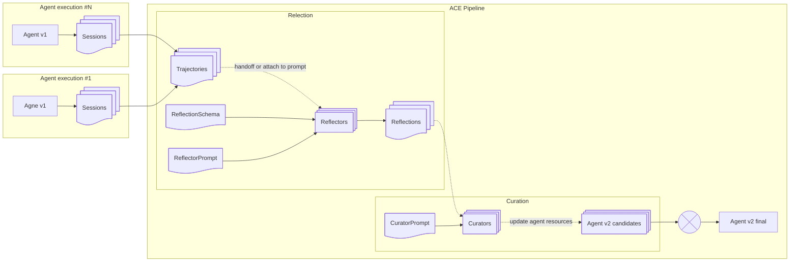
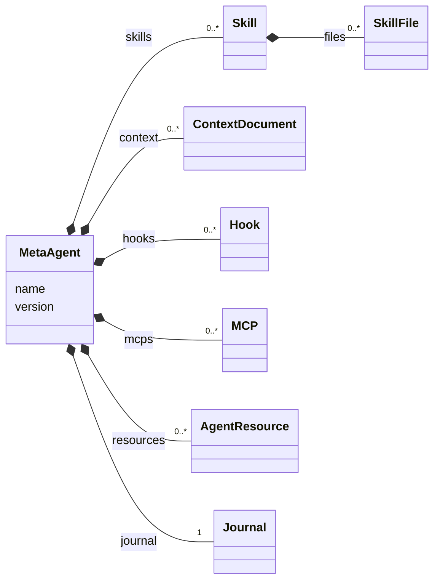
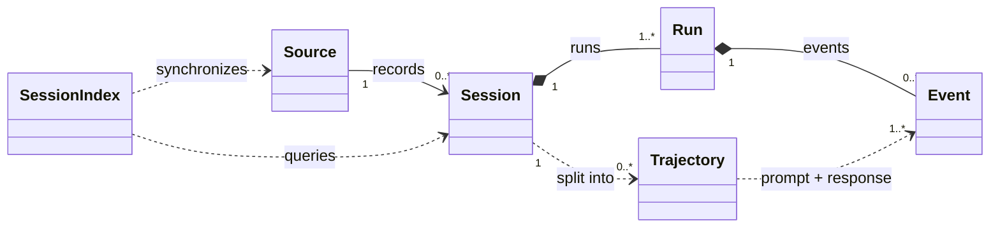

# Glossary

Shared definitions for `thearc`. These describe the domain first and identify
current Python types where useful. A concept can exist without a dedicated class.

## The learning cycle



## MetaAgent

### MetaAgent

A **MetaAgent** is the portable, harness-independent definition of everything that
shapes an agent's behavior apart from the model itself: its skills, context
documents, hooks, MCP connections, and other harness resources. It is the unit
the learning cycle improves — reflection assesses it and installation deploys
it.

A MetaAgent is *configuration*, not execution:

- An **Agent** is the running system; a MetaAgent is what gets installed into
  its harness before it runs. The same MetaAgent can be installed into different
  harnesses (Claude Code, Codex, Antigravity, Pi).
- A MetaAgent does not record what an agent actually loaded during a historical
  session. Linking a session to the configuration it ran with requires the
  installed identity (name and version), not the current definition.



### Identity

A MetaAgent is identified by a **name** and an optional **version**. The name is
a single safe filename component, so it can name directories and version markers
on disk. The version is a free-form, single-line label; it carries no ordering
semantics. Installation writes both, together with the revision, into the target
as an **identity marker** so an installed configuration can be traced back to the
exact MetaAgent configuration it came from.

### Installation

**Installation** deploys a MetaAgent into one harness's native project layout:
skills as `SKILL.md` with YAML frontmatter, rules/workflows/commands into their
directories, context documents at the project root, and hooks and MCP servers
merged into the harness's own configuration files. Supported harnesses are
`claude`, `codex`, `antigravity`, and `pi`.

An installation **owns** what it wrote; the identity marker lists those files,
context sections, hooks, and MCP servers. Reinstalling replaces exactly what it
owns and leaves everything else in the project alone. Importing an installation
reads the harness layout back into a MetaAgent.

- **Rebuilt files** — skills, rules, workflows, commands, and hook scripts are
  written whole. Overwriting a file the MetaAgent does not own is a conflict
  unless forced.
- **Merged context documents** — `AGENTS.md`, `CLAUDE.md`, and the like usually
  hold the project's own instructions. If one already exists, the MetaAgent's
  top-level sections are merged by heading title: a section with the same title
  is replaced in place, a new one is appended, and the rest of the document is
  kept. Sections the MetaAgent no longer has are removed on reinstall. A
  document thearc created is owned whole.
- **Merged configuration** — hooks and MCP servers go into the harness's own
  files (`.claude/settings.json`, `.mcp.json`, `.codex/hooks.json`,
  `.codex/config.toml`, ...) next to entries the MetaAgent does not own.
  Resources a harness cannot express (Pi has no hooks or MCP servers) are
  skipped and reported.

### Resource

A **resource** is one independently addressable part of a MetaAgent. Each kind
is keyed by its own identity, which is unique within its collection.

| Resource | Keyed by | Meaning |
| --- | --- | --- |
| `Skill` | name | Reusable instructions, metadata, and supporting files for a capability. |
| Skill file | `<skill>/<path>` | A supporting file bundled with a skill. |
| `ContextDocument` | filename | Always-loaded instructions such as `AGENTS.md` or `CLAUDE.md`. |
| `Hook` | name | An action the harness runs on an event (e.g. `pre_tool_use`). |
| `MCP` | name | A connection to a Model Context Protocol server. |
| `AgentResource` | `<location>/<path>` | A harness-specific file: a rule, workflow, or command. |

Resources are data. Defining, loading, comparing, or saving a MetaAgent never
executes a hook, script, or MCP server.

### Resource target

A **resource target** is the stable address of a resource, optionally narrowed
to one Markdown section of it: `(kind, name, section?)`. Reflectors cite file
references that resolve to targets, and ratings accumulate on them. A target's ID is derived from its address only,
so editing content or ratings never changes it. Hooks and MCPs are structured, not Markdown, and therefore have no sections.

A section is addressed by its **heading path** — the titles of the heading and
its ancestors joined by ` > `, e.g. `Usage > Examples`. Two `Examples`
headings under different parents are therefore separately addressable. A
heading path that occurs twice in one document has no address of its own; its
lines belong to the nearest addressable ancestor.

### Rating

A **rating** is one judgment about a resource target, expressed on a rating
scale — for example "this section was *helpful*" or "this skill scored *0.8*".
Ratings come from assessments (typically a reflection over a session) and are
evidence *about* the configuration, not part of its instructions.

Every rating is traceable. It records:

- the **target** and the **revision** of the MetaAgent it judged, so a rating
  given to old content stays distinguishable from one given to the current
  content;
- any **extra** fields the caller attaches when recording it, e.g. the
  reflector or the session it came from;
- its **metadata** — operator-defined fields explaining the judgment, such as
  an insight or a root-cause analysis. Metadata is never aggregated; it is
  kept for people, curators, and later analysis to read.

### Reflection schema

A **reflection schema** is the operator-defined contract for what a reflection
returns: a list of items, each validated against the schema before anything
is recorded. Every item has a fixed core and a loosely defined remainder:

| Part | Defined by | Content |
| --- | --- | --- |
| Reference | `thearc` | `ref` — a file reference to the judged lines (see File reference). |
| Rating | Rating scale | The value on the schema's rating scale, e.g. `harmful`. |
| Metadata | Operator | Any further fields, e.g. `insight`, `root_cause_analysis`. |

```json
[
  {
    "ref": "skills/retry/SKILL.md#L12-L30",
    "rating": "harmful",
    "insight": "The retry rule made the agent loop on a permanent error.",
    "root_cause_analysis": "Rule does not distinguish transient from permanent failures."
  }
]
```

Each validated item becomes one Rated journal entry per target its reference
resolves to. `thearc` adds what the reflection itself cannot be trusted to
supply — the resolved target and the revision it judged — plus any extra fields
the caller passes, so each entry is complete and traceable. Entries keep the original
`ref` and share an item ID, so the entries produced by one judgment can be
recognised as such (for example by a rating policy). An item that fails validation, or whose `ref`
does not resolve in the judged revision, is rejected rather than recorded.

### File reference

A **file reference** points at lines of the agent files a reflector reads:

| Form | Meaning |
| --- | --- |
| `path#Lx` | One line, e.g. `skills/retry/SKILL.md#L42`. |
| `path#Lx-Ly` | A line range, inclusive, e.g. `skills/retry/SKILL.md#L12-L30`. |

Line numbers start at 1, matching what editors and `cat -n` show.

`path` is relative to the root of the agent files, so two skills' `SKILL.md`
files are never confused. Line numbers refer to the rating-free agent files of
the judged revision, so they are stable for that revision.

**Reference resolution** maps a file reference to the resource targets that
receive the rating: every innermost target the range overlaps — a Markdown
section, or the whole resource for lines outside any section (such as a hook,
an MCP, or a preamble before the first heading). A range within one section
resolves to that section; a range spanning two sections resolves to both. A
reference to a missing file, or beyond the end of a file, does not resolve.

### Rating scale

A **rating scale** defines which values a rating may take and how many ratings
combine into one summary. `thearc` does not fix a scale; a user chooses or
defines one, and several scales can be used on the same MetaAgent side by side.

| Kind | Values | Summary | Example |
| --- | --- | --- | --- |
| Categorical | A fixed set of labels, optionally ordered | Count per label | `harmful < neutral < helpful` |
| Label | Any short string; the set is not declared up front | Count per label | `outdated`, `too-verbose`, `duplicates:skill-x` |
| Numeric | Numbers, optionally bounded | Count, sum, min, max (mean derived) | `0.0 – 1.0` quality score |

A scale is identified by name, so ratings and summaries from different scales
never mix. A label scale works like tags: values are open-ended, but each one
is still counted, so "three reflections called this section `outdated`" is a
summary like any other. A label scale may normalise values (e.g. lowercase,
trimmed) so that the same label is not counted under two spellings.

### Rating summary

A **rating summary** is the aggregate of all ratings on one target for one
scale, derived from the journal; it is never edited directly. Summaries are *mergeable*: combining the summaries of two disjoint sets
of ratings equals summarising their union. This is why numeric scales keep
count and sum rather than a mean, and it lets summaries from separate runs or
candidate MetaAgents be combined. A target with no ratings has no summary,
which differs from a summary of zero counts.

The journal keeps every rating; which of them a summary counts is decided by a
**rating policy** chosen by the operator of a pipeline, not by the MetaAgent.
Examples: count all ratings, drop ratings given before the target's last
modification, or decay older ratings. Policies only read the journal, so
switching policy never loses history.

A scale also defines how a summary renders next to a target (for example the
heading suffix `(harmful: 1, neutral: 0, helpful: 3)`). Rendering is a
**rating view**, with two forms:

- **Annotated files** — the agent files with each rated section's heading
  suffixed by its summary. Only heading lines change, so file references stay
  valid.
- **Outline** — every resource and section with its file reference and
  summary, including whole resources such as hooks, which have no heading.

A view is never parsed back: the rating-free MetaAgent is what reflectors read,
revisions hash, and comparisons use.

### Journal

The **journal** is a MetaAgent's append-only history. It is part of the
MetaAgent but not of its configuration: it travels with the MetaAgent, yet it
does not change its revision. Each entry is about one resource target and
records the revision it applies to, when it happened, and any **extra** fields
the caller attaches (for example who or what caused it). Each entry is one of:

| Entry | Records |
| --- | --- |
| Added | A target came into existence (a resource or a new Markdown section). |
| Modified | A target's content changed between two revisions (before/after text and hashes). |
| Moved | A target's address changed (a renamed section or resource); its history carries over. |
| Removed | A target ceased to exist. |
| Rated | A validated reflection item: target, rating, reference, and metadata (see Reflection schema). |

Current state is derived from the journal: which targets exist and since when,
how often each has changed, and every rating summary. Because target IDs come
from addresses, a section keeps its history across edits; a rename gets a new
address, and the Moved entry links the old ID to the new one.

### Version control

A MetaAgent's workspace is tracked with git. Git and the journal complement
each other:

- **Git** stores the full content of every revision and answers *what the
  files looked like*.
- **The journal** answers *what happened to each target, who did it, and on
  what evidence* — at the level of skills and sections rather than lines.

Changes reach the journal through commits. Whoever edits the workspace — a
curator agent, a person, a process — commits each change with **its reason as
the commit message**, ideally one change per commit. **Recording commits** then
walks the commits the journal has not seen yet (first parents only) and compares
each with its parent: every changed target gets its own entry carrying the
commit message as its `reason`, the commit hash, and the target's text before
and after. A commit touching two sections yields two entries with the same
reason; a new heading yields Added (its ID is derived from its address, so
nothing is generated or stored). Uncommitted edits are not recorded. When a
move cannot be determined reliably — typically a section renamed and edited in
the same commit — it is recorded as Removed plus Added, so renames belong in
their own commit.

A section's **change log** is its change entries across moves: what changed,
when, in which commit, and why.

The source of truth for the journal is a git branch. What each step of the
learning cycle may see, and when its entries are committed:

| Step | Sees the journal | Commits to the journal |
| --- | --- | --- |
| Reflection | No — ratings must not be biased by earlier ratings | Rated entries, once reflection finishes |
| Curation | Yes — history and ratings guide changes | Added / Modified / Moved / Removed entries, with the changed content |
| Merging | Yes | A resolution commit on top of the base journal |

Several **candidates** can be developed in parallel, each in its own git
worktree branched from the same base. The **merger** resolves them, including
conflicts, into one new candidate, committed on top of the base journal so
that the history of every candidate's changes and ratings is preserved.

### Representations

The same MetaAgent has several representations. Conversions between them must be
lossless for configuration content.

| Representation | Purpose |
| --- | --- |
| Model | The in-memory Python object (`MetaAgent`). |
| Workspace | A canonical, editable, git-tracked directory: the agent files, an `agent.json` manifest (name, version), and `journal.jsonl` with one entry per line (union-merged by git); harness-independent. |
| Installation | The harness-native layout (e.g. `.claude/`, `.codex/`) produced by `install()` and read back by `from_installation()`. |
| Agent files | The configuration as files, in the same layout as the workspace: `skills/<name>/SKILL.md`, `context/…`, `rules/…`, `hooks.json`, `mcp.json`. What a reflector reads and cites. |
| Revision | A content hash of the agent files only (no identity, journal, or ratings), pinning which configuration a journal entry refers to. |

## Sessions

What an agent did, as recorded by its harness. Sessions are the evidence that
reflection judges a MetaAgent by. They are read from the harness's own
transcripts and never modified.



### Source

A configured directory of native transcripts from one harness (`claude`,
`codex`, `antigravity`, `pi`, `opencode`), in its native format or an export
format such as `dataclaw`. A source has a stable ID; everything read from it is
scoped to that ID. Sources are only read.

### Event

One normalized record of agent activity: a message, a tool call, a tool result,
or a metadata record. An event keeps its normalized fields (kind, role, text,
tool, status, …), the raw native record, and a **source reference** — file,
byte offset, and line — so it can always be traced back to the transcript.

### Session

One recorded conversation with an agent, as the harness stored it: its
identity, metadata (title, working directory, start and end), and its events in
recorded order. A session can contain several runs, including delegated work.

A session has two IDs: its **native ID**, assigned by the harness, and its
**canonical ID**, assigned by the index and scoped to the source. APIs that
resume or fork a native session need the native ID; queries use the canonical
ID.

### Run

An execution context within a session: the main agent, or a sub-agent it
delegated to. A run may name a parent run, which forms the delegation tree.

### Trajectory

The activity triggered by one user prompt: the **prompt** (one or more content
blocks of one user message) and the **response** — every event that follows
until the next prompt, a recorded completion or interruption, or the end of the
stream. A session is a sequence of trajectories:

```text
S  = (t0, t1, ..., tk)
ti = (prompt_i, e_i0, e_i1, ..., e_iN)
```

A trajectory records its **boundary**: why it ended (`completed`,
`interrupted`, `next_prompt`, `end_of_stream`, or `stream_boundary`). Only
`completed` and `interrupted` come from the harness; the others say where the
recording stops, not whether the work succeeded. Splitting a session into
trajectories is lossless: events before the first prompt, or outside any
response, are kept as **unassigned events**. A trajectory's ID is the ID of its
first prompt event.

### Session index

The local, queryable copy of sessions (SQLite). **Synchronizing** a source reads
its transcripts incrementally and records their sessions, runs, and events; the
transcripts themselves are never changed. The index answers listing, full-text
search, filtering, and context queries, and it resolves any event back to its
source record.

The index is also where sessions are **kept**: when a transcript disappears
from its source, its indexed events are marked unavailable but stay searchable.
It is therefore a store as well as an index, and `thearc` uses one name for it —
session index — rather than two.

### Session view

A session up to and including one trajectory: everything the agent had seen
when that trajectory ended. It must end at a recorded trajectory boundary.

### Export

A session, trajectory, or session view written in a harness's own transcript
format — `claude`, `codex`, `pi`, `opencode`, or `antigravity` — or as canonical
`thearc` JSONL. Prompts, replies, thinking, tool calls with their results and
status, system messages, and compaction summaries use the target's native form
where it has one. An export is **strict** by default: anything the target
cannot represent faithfully (thinking without the signature Claude requires,
Codex's encrypted reasoning, …) is refused. A **best-effort** export keeps such
events as clearly labelled text and lists each one, by event ID, in the
export's transformations.

### Session installation

An export written where a harness looks for sessions, so the harness can resume or
fork it — for example a Claude trajectory installed into Codex so a Codex
reflector can fork it. An installed session is a **copy** with its own ID,
derived from the selected events and the target harness: installing the same
selection again finds the earlier copy, which is replaced only on request. In
Codex, each trajectory becomes one turn, so a fork can stop at any trajectory.
Codex, Claude, and Pi load installed files directly; OpenCode needs an import
command; Antigravity cannot load transcripts at all.

### Harness

The agent environment that records sessions and runs a MetaAgent: `claude`,
`codex`, `antigravity`, `pi`, or `opencode`. Sessions can be read from all of
them; installation supports `claude`, `codex`, `antigravity`, and `pi`. A
harness's **layout** is where installed configuration goes in a project.

### In code

| Concept | `thearcv2` |
| --- | --- |
| Entry point: add sources, synchronize, list, resolve, get, search | `sessions.Sessions` |
| Session | `sessions.Session` (immutable; events read from a pinned index snapshot) |
| Trajectory, and a session split into them | `sessions.Trajectory`, `sessions.TrajectorySplit` |
| Session view | `sessions.SessionView` (`session.through(trajectory)`) |
| Session index | `sessions.SessionIndex` |
| Records the index stores | `sessions.SessionMetadata`, `Run`, `Event`, `SourceConfig`, `IndexHit` |
| Behavioral patterns | `sessions.scanner` |
| Export to a harness format | `session.export(format)`, `sessions.export_events` (`sessions.export`) |
| Session installation | `session.install(harness)`, `Sessions.install_all`, `thearcv2 s install` |
| Harness names; installation layout | `harnesses.Harness`; `resources.HarnessLayout` |
| Command line | `python -m thearcv2 sessions …` (`sessions.cli`) |
